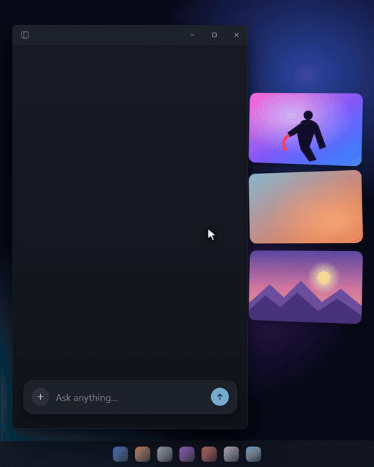

<p align="center">
  
</p>

<h1 align="center">Perch</h1>

<p align="center">A temporary screenshot shelf for Windows.<br/>Snips land, perch for a while, then fly off.</p>

---

Windows' <kbd>Win</kbd>+<kbd>Shift</kbd>+<kbd>S</kbd> only puts a screenshot on the clipboard, so
you can paste it but can't drag it into an upload box. Perch catches every image that lands on
the clipboard, shows it as a card at the edge of your screen, and lets you drag it into any app or
browser drop zone as a real PNG file. Snips expire on their own.

<p align="center">
  
</p>

> **Download:** grab `Perch-Setup-x.y.z.exe` from the
> [latest release](https://github.com/dan0dev/perch/releases/latest) and run it. One click, no
> admin rights, Windows 10 or 11. More at [perchwebsite.vercel.app](https://perchwebsite.vercel.app).
>
> Free code signing provided by [SignPath.io](https://signpath.io), certificate by
> [SignPath Foundation](https://signpath.org).

## Shortcuts

| Keys | What it does |
| --- | --- |
| <kbd>Win</kbd>+<kbd>Shift</kbd>+<kbd>S</kbd> | Take a snip (Windows). It lands on the shelf. |
| <kbd>Ctrl</kbd>+<kbd>Alt</kbd>+<kbd>S</kbd> | Show or hide the shelf. |
| Drag a card | Drop it into any app or upload box as a PNG. |
| Click a card | Select it. Drag any selected card to take them all. |
| Double-click a card | Open it in your image viewer. |
| Bin on a card (on hover) | Delete it right away. |
| **…** on a card | Copy, Save as, Pin, Delete. |
| Tray icon | Click to show or hide the shelf; right-click for the menu and Settings. |

Snips fly off after 15 minutes; change that and more in Settings. All the details are in the
[guide](docs/GUIDE.md).

## Privacy

Perch makes no network calls and has no telemetry. Images are only read from the clipboard
(never text), stored in `%TEMP%\Perch`, and that folder is emptied on start and on quit.

## Develop

Requires Node 22+ and Windows 10/11.

```bash
npm install        # .npmrc sets legacy-peer-deps (works around an npm 10 resolver crash)
npm run dev        # run with hot reload
npm test           # unit tests (Vitest)
npm run build      # installer and zip in dist/
```

## Known limits

- **SmartScreen warning.** The installer isn't code-signed yet, so Windows shows "Windows
  protected your PC" on first run. Choose *More info* → *Run anyway*.
- **Admin apps.** Windows blocks drag and drop from a normal app into an app running as
  administrator. Copy the card (… → Copy) and paste instead.

## License

[MIT](LICENSE) © 2026 Dániel K
