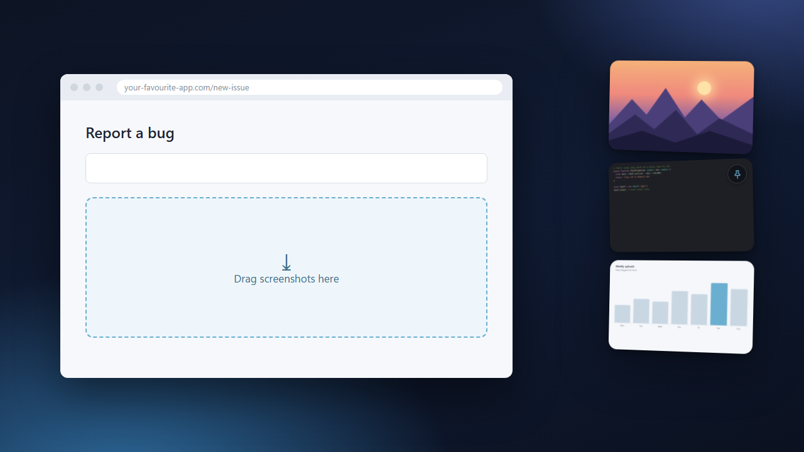

<p align="center">
  
</p>

<h1 align="center">Perch</h1>

<p align="center">
  Drag your Win+Shift+S screenshots into any app.<br/>
  Snips land, perch for a while, then fly off.
</p>

<p align="center">
  <a href="https://github.com/dan0dev/perch/releases/latest"><b>Download for Windows</b></a>
</p>

<p align="center">
  
</p>

Windows only puts screenshots on the clipboard, so you can paste them but not drag them into an
upload box. Perch shows every copied image as a card at the edge of your screen. Drag it
anywhere as a real PNG file. Cards expire after 15 minutes (you can change that).

## Install

Download `Perch-Setup-x.y.z.exe` from the
[latest release](https://github.com/dan0dev/perch/releases/latest) and run it. No admin rights
needed. Windows 10 or 11, 64-bit.

> **"Windows protected your PC"?** Perch isn't code-signed yet. Click
> **More info → Run anyway**.

## Use

1. Take a snip with <kbd>Win</kbd>+<kbd>Shift</kbd>+<kbd>S</kbd>.
2. Drag the card that appears into any app or upload box.

<kbd>Ctrl</kbd>+<kbd>Alt</kbd>+<kbd>S</kbd> shows or hides the shelf. Hover a card for
**…** (Copy, Save as, Pin, Delete); double-click to open it. Settings live in the tray icon's
menu. All the details are in the [guide](docs/GUIDE.md).

## Privacy

No network, no telemetry, no account. Perch only reads images from the clipboard, never text,
and deletes them when they expire or when it quits.

## Build

```bash
npm install && npm run dev     # run
npm test                       # tests
npm run build                  # installer in dist/
```

## License

[MIT](LICENSE) © 2026 Dániel K
